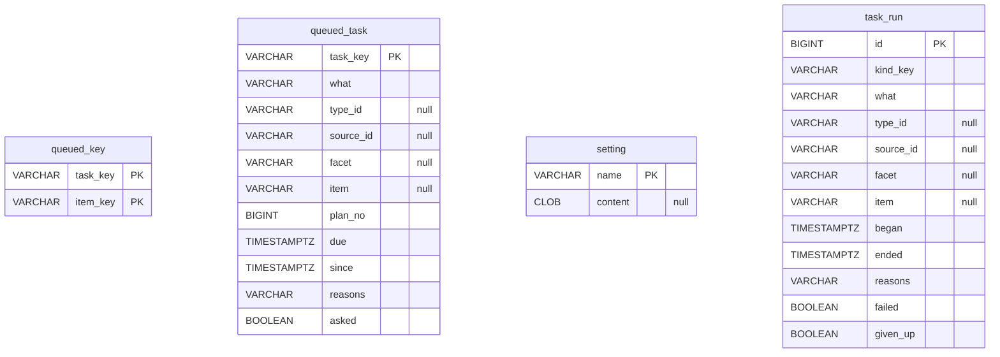

# The application: `app`

`app.mv.db` — The application's own database, one of it: its settings and the settings and job states of every source,
and the queue of its computations with their last runs.

| Table | What it holds |
|---|---|
| `setting` | a setting by its name ("encoder.text", "source.<id>.…", "job.<id>.running"), its value as text |
| `queued_task` | a task of the queue not done yet — planned, waiting its turn or running — from its plan to its end: what it is, its plan's number, when it is due, since when, why, whether the user asked; what a stop or a crash left is planned again at the next start |
| `queued_key` | what a task of the queue is to be done of — an item, a fandom its owner names, a key a row — kept till it is done: a stop leaves them to the task planned again at the next start |
| `task_run` | the last runs of every kind of task: when each began and ended, why, whether it failed or was given up — what a task to come is expected to take |

The diagram is made of the migrations by `SchemaDocsTest`: change it with them.

