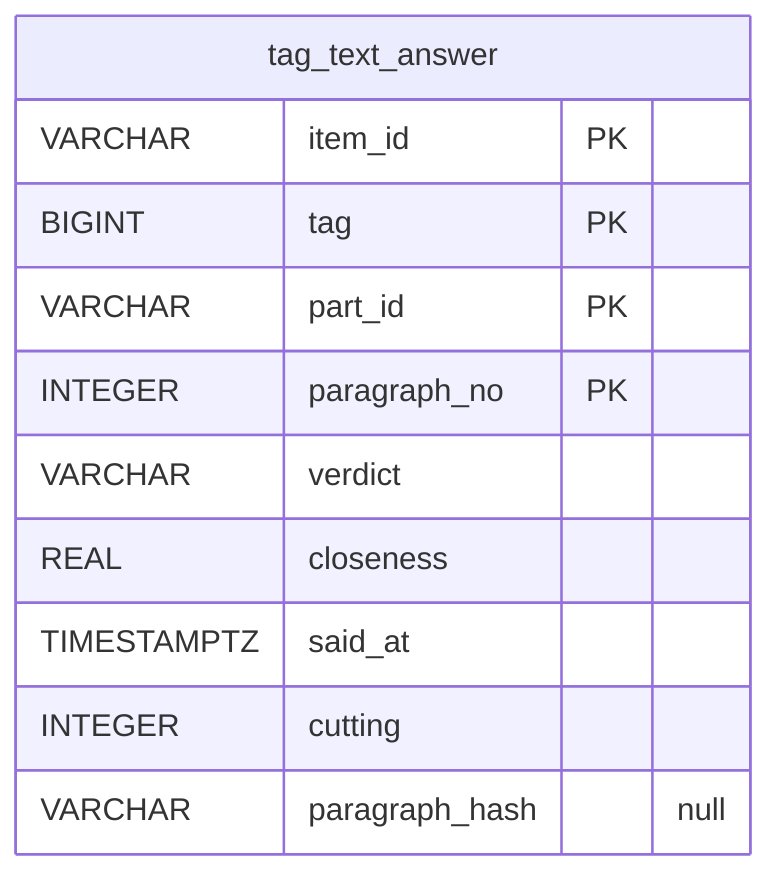

# A source's corrections: `corrections`

`sources/<source>/corrections.mv.db` — The user's word on the paragraphs of the texts of one source's works. Backed up on every start. The user's word on values and fields, and which works are one or related, stand on the normalized works, in the [dictionaries](dictionaries.md).

| Table | What it holds |
|---|---|
| `tag_text_answer` | the user's word on a tag offered by a paragraph of a work's text, bound to the paragraph by the hash of its text: yes, the paragraph is of it but not enough, or wrong — with their closeness then and the cutting it was given on |

The diagram is made of the migrations by `SchemaDocsTest`: change it with them.

