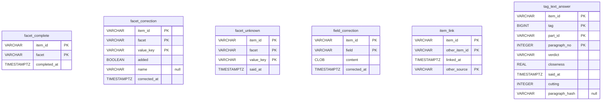

# A source's corrections: `corrections`

`sources/<source>/corrections.mv.db` — The user's word on the works of one source: values of facets confirmed, added or taken away, fields overridden, duplicates merged within the source. Backed up on every start.

| Table | What it holds |
|---|---|
| `facet_correction` | the user's word on a value of a facet of a work: added (true) or taken away (false) |
| `facet_complete` | the user said a work's values of a facet are all named |
| `facet_unknown` | the user's word that whether a work has a value is not clear of it (a pairing): asked so no more, nothing learnt |
| `field_correction` | a field of a work as the user wrote it: the title, a text, a number |
| `item_link` | two works the user said are one: of the source, or of it and another source of the content type — kept by the source of the smaller key |
| `tag_text_answer` | the user's word on a tag offered by a paragraph of a work's text, bound to the paragraph by the hash of its text: yes, the paragraph is of it but not enough, or wrong — with their closeness then and the cutting it was given on |

The diagram is made of the migrations by `SchemaDocsTest`: change it with them.

