# The dictionaries: `dictionaries`

`dictionaries.mv.db` — The user's dictionaries, one of them for every content type: the tags of every site as the user merges, names, links, binds to Wikidata and ignores, what is counted and encoded of them in the background, and the universes with their characters. Backed up on every start.

| Table | What it holds |
|---|---|
| `normalized_tag` | a tag of the user's: its id, the name the user gave it, whether it is ignored |
| `site_tag` | a site's tag bound to a normalized tag, with its name and works as last counted |
| `tag_stat` | a tag's works, graded and liked among them, and the sources of its sites' tags, as last counted; the name worked out of its entry or its sites' tags (`calculated_name`) and the rule it was worked out by |
| `tag_vector` | the vectors of every name of a tag by a text encoder's plugin and model |
| `normalized_tag_parent` | a tag under another |
| `normalized_tag_distinct` | two tags the user told apart |
| `normalized_tag_merge` | a tag merged into another whose answers are still to be moved |
| `normalized_tag_entry` | an entry of a catalogue (Wikidata) a tag is bound to |
| `tag_entry` | an entry of a catalogue as it was read |
| `tag_entry_text` | the labels, aliases and descriptions of an entry by language |
| `tag_entry_above` | the entries an entry is a kind of |
| `tag_entry_too_general` | an entry the user said is too general to be a tag above others: offered so no more |
| `tag_offers` | the offers of the tags' graph as last worked out with the names of the tags, in the queue of the computations: a request reads them, never waits for them |
| `tag_text_model` | the model of how close a tag and a paragraph are when the work has the tag, learnt from the user's answers: the slope and the intercept, and every answered tag's own bias |
| `age_rating_weight` | the model of a work's age rating by its tags and its site, learnt from every site's works whose rating is known to lie between two steps: every feature's weight ("tag:<id>", "source:<id>"), and the thresholds between the ratings ("threshold:<k>") |
| `universe` | a universe of the dictionary: an entry of a catalogue the user added |
| `universe_property` | what else the catalogue says of a universe |
| `universe_character` | a character of a universe |
| `universe_character_property` | what else the catalogue says of a character |
| `universe_character_class` | the classes a character is an instance of |
| `universe_class` | a class of the catalogue, and whether its instances are characters |
| `universe_class_choice` | the user's word on a class of a universe |
| `universe_character_choice` | the user's word on one character of a universe |
| `dictionary_moved` | the files of the types whose tags and universes were moved here |

The diagram is made of the migrations by `SchemaDocsTest`: change it with them.

```mermaid
erDiagram
    age_rating_weight {
        VARCHAR feature PK
        DOUBLE weight
        INTEGER works
        TIMESTAMPTZ fitted_at
    }
    dictionary_moved {
        VARCHAR owner PK
        TIMESTAMPTZ moved_at
    }
    normalized_tag {
        BIGINT id PK
        VARCHAR name "null"
        BOOLEAN ignored
    }
    normalized_tag_distinct {
        BIGINT first_tag PK, FK
        BIGINT other_tag PK, FK
        TIMESTAMPTZ said_at
    }
    normalized_tag_entry {
        BIGINT tag PK, FK
        VARCHAR catalogue PK, FK
        VARCHAR entry PK, FK
        TIMESTAMPTZ bound_at
    }
    normalized_tag_merge {
        BIGINT from_tag PK
        BIGINT into_tag
        TIMESTAMPTZ merged_at
    }
    normalized_tag_parent {
        BIGINT child PK, FK
        BIGINT parent PK, FK
        TIMESTAMPTZ linked_at
    }
    site_tag {
        VARCHAR source PK
        VARCHAR tag PK
        BIGINT normalized FK
        TIMESTAMPTZ bound_at
        VARCHAR name "null"
        INTEGER works
        INTEGER graded
        INTEGER liked
    }
    tag_entry {
        VARCHAR catalogue PK
        VARCHAR entry PK
        VARCHAR url
        TIMESTAMPTZ fetched_at
        TIMESTAMPTZ above_read_at "null"
    }
    tag_entry_above {
        VARCHAR catalogue PK, FK
        VARCHAR entry PK, FK
        VARCHAR above PK, FK
    }
    tag_entry_text {
        VARCHAR catalogue PK, FK
        VARCHAR entry PK, FK
        VARCHAR language PK
        CHAR kind PK
        INTEGER position PK
        VARCHAR text
    }
    tag_entry_too_general {
        VARCHAR catalogue PK, FK
        VARCHAR entry PK, FK
        TIMESTAMPTZ said_at
    }
    tag_offers {
        INTEGER id PK
        TIMESTAMPTZ made_at
        CLOB offers
    }
    tag_stat {
        BIGINT tag PK, FK
        INTEGER works
        INTEGER graded
        INTEGER liked
        VARCHAR_ARRAY sources
        VARCHAR calculated_name "null"
        VARCHAR calculated_rule "null"
    }
    tag_text_model {
        BIGINT tag PK
        DOUBLE bias
        DOUBLE slope "null"
        INTEGER answers
        TIMESTAMPTZ fitted_at
    }
    tag_vector {
        BIGINT tag PK, FK
        VARCHAR plugin PK
        VARCHAR model PK
        VARBINARY_ARRAY vectors
    }
    universe {
        VARCHAR catalogue PK
        VARCHAR universe_id PK
        VARCHAR name
        VARCHAR description "null"
        VARCHAR url
        TIMESTAMPTZ added_at
        TIMESTAMPTZ refreshed_at
        CLOB labels "null"
        CLOB descriptions "null"
        VARCHAR languages "null"
        VARCHAR properties "null"
    }
    universe_character {
        VARCHAR catalogue PK, FK
        VARCHAR universe_id PK, FK
        VARCHAR character_id PK
        CLOB names
        VARCHAR description "null"
        VARCHAR url
        VARCHAR sex "null"
        CLOB labels "null"
        CLOB aliases "null"
        CLOB descriptions "null"
    }
    universe_character_choice {
        VARCHAR catalogue PK, FK
        VARCHAR universe_id PK, FK
        VARCHAR character_id PK
        BOOLEAN included
    }
    universe_character_class {
        VARCHAR catalogue PK, FK
        VARCHAR universe_id PK, FK
        VARCHAR character_id PK, FK
        VARCHAR class_id PK
    }
    universe_character_property {
        VARCHAR catalogue PK, FK
        VARCHAR universe_id PK, FK
        VARCHAR character_id PK, FK
        VARCHAR property PK
        VARCHAR property_value PK
    }
    universe_class {
        VARCHAR catalogue PK
        VARCHAR class_id PK
        VARCHAR name
        BOOLEAN is_character
        CLOB labels "null"
    }
    universe_class_choice {
        VARCHAR catalogue PK, FK
        VARCHAR universe_id PK, FK
        VARCHAR class_id PK
        BOOLEAN included
    }
    universe_property {
        VARCHAR catalogue PK, FK
        VARCHAR universe_id PK, FK
        VARCHAR property PK
        VARCHAR property_value PK
    }
    normalized_tag ||--o{ normalized_tag_distinct : "first_tag"
    normalized_tag ||--o{ normalized_tag_distinct : "other_tag"
    normalized_tag ||--o{ normalized_tag_entry : "tag"
    normalized_tag ||--o{ normalized_tag_parent : "child"
    normalized_tag ||--o{ normalized_tag_parent : "parent"
    normalized_tag ||--o{ site_tag : "normalized"
    normalized_tag ||--o{ tag_stat : "tag"
    normalized_tag ||--o{ tag_vector : "tag"
    tag_entry ||--o{ normalized_tag_entry : "catalogue, entry"
    tag_entry ||--o{ tag_entry_above : "catalogue, above"
    tag_entry ||--o{ tag_entry_above : "catalogue, entry"
    tag_entry ||--o{ tag_entry_text : "catalogue, entry"
    tag_entry ||--o{ tag_entry_too_general : "catalogue, entry"
    universe ||--o{ universe_character : "catalogue, universe_id"
    universe ||--o{ universe_character_choice : "catalogue, universe_id"
    universe ||--o{ universe_class_choice : "catalogue, universe_id"
    universe ||--o{ universe_property : "catalogue, universe_id"
    universe_character ||--o{ universe_character_class : "catalogue, universe_id, character_id"
    universe_character ||--o{ universe_character_property : "catalogue, universe_id, character_id"
```

