# A content type's model: `model`

`types/<type>/model.mv.db` — What is learnt of one content type and made of it: all of it recomputable.

| Table | What it holds |
|---|---|
| `model` | the current model of the grades: its scorer, description and packed state |
| `prediction` | the predicted grade of every work, 0..10, and its chance of interest |
| `average_work` | the average work of the type as the last pass of the expectations counted it — the mean and the spread of every vector block and number, the share of every categorical feature, the mean picture — packed, with the format and the basis of the vectors (the encoders, the directions of the sets) it was counted of: what a training reads instead of every work |
| `score_sweep` | where the pass of the expectations by a new model stands while one goes on: the model it scores by, since when it goes, how many items it scored and changed, the sums of the average work counted so far |
| `held_out` | the prediction of every graded work by a model that had not seen it |
| `held_out_explained` | what a model that had not seen a graded work says of it — score, where the grade stands, what moves it — worked out in the queue once the work is opened, gone with every training and every word on the work |
| `set_embedding` | the directions the sets of the works are embedded by |
| `manner_words` | the words a manner of a text is measured by: the most frequent words of the works' texts, each with the mean and the spread of its share, and of how many texts |
| `group_manner` | the manner of every normalized author and every normalized series: the mean of the manners of their works that have a text, with the hash of what it was made of — the words, the works and the texts of their items |
| `fandom_likeness` | the likeness of the names of the sites' fandoms learnt of the user's word on the universes: a weight of every dimension of their vectors, and how many of the pairs of the universes held out it put in the user's order beside the encoder's own; kept in the model database of the first content type of universes |
| `mark_likeness` | how every work is alike what the user marked |
| `mark_likeness_strength` | every work's strength of likeness to every mark |
| `mark_likeness_axes` | a work's four axes of likeness to the marks |
| `facet_suggester` | the fitted state of the suggester of a facet — the model the chances of a work's values are made by when the work is read, none of them kept — the values it chooses from, its scoring of them apart from their names (every value's coordinates and bias, read by a page in place of the dictionary), its calibration by the user's answers with the cutoff of the likely (`calibration`), and how it was fitted: the report of what it tried and chose, how long it took, how many works and values it learnt from |
| `layer_draft` | a value a source drafts of a work from its own values through the dictionary of universes |
| `search_score` | the reranker's score of a work for a line searched |
| `search_query_shift` | the closeness of a line and a passage by meaning corrected by the user's judgments: q·p + (q·a)(b·p), the two vectors of weights of the dimensions of the text encoder's vectors; the line's vector moved by it before it is searched |
| `search_weight` | the order of what a search finds learnt of the user's judgments: of every feature a work is found by — how close by meaning, how its words matched, the reranker's score — its weight on its own scale |
| `duplicate_candidate` | two works of different sites that may be one, as the last search of the duplicates found them — of every work the likeliest of every other site — with how alike each layer of theirs is: the title, the description, the size, every facet the sites share (`facets`, "<facet>=<cosine>" a line), whether the dictionary of authors gives them one author, fully or in part (`same_author`), and the works it was found for (`found_for`: 1 the first, 2 the second, 3 both); the title compared letter by letter — the cosine of the trigrams (`title`) and how much of either the other has (`title_within`, `title_holding`) — and the names of the authors the same (`authors_alike`, `authors_within`, `authors_holding`, none of a pair of no names); the other way, the title by meaning (`title_vector`) and the other texts letter by letter — the description, the sites' names of the fandoms, the sites' lines of the characters (`description_letters`, `fandom_letters`, `character_letters`), none of a pair either of whose has none — and an author only in part one (`partly_same_author`); the words of either work the search compared them by, stated or worked out of the characters (`words`, `other_words`): what the pairs are sorted by their size by; and, worked out when the search fills the table — what a page of them is chosen and ordered by in the database, each sort of an index of its own beside the word on the pair —: the chance of one work and of one series by the models of the answers (`same_chance`, `series_chance`), the user's word on the pair as the search or the last answer left it (`answer`, none of an open one; `answer_derived`: of one series by the series), whether the two works have every normalized author and the title alike (`same_authors`, `same_title`), and the key of every other sort (`by_size`, `by_series_size`: the mean size times either chance; `by_doubt`, `by_series_doubt`: how near either chance is to where the answers change; `by_formula`, `by_interest`, `by_grade`: the found work's worth by the prediction and the user's marks of interest times the chance) |
| `work_size_model` | the model of how many words a site item has to a character, in one row: its weight of every feature — the site, the item's tags, languages and normalized authors as the index of the list holds them — by the feature's name, how every site counts the characters of our texts' classes, and the variances the next fitting begins at, packed (`content`), with when it was fitted; fitted again in the queue only when an item gives it something new to learn of; the other of an item's two sizes is worked out of it where it is read |
| `author_candidate` | two normalized authors who may be one, as the last search of the authors' duplicates found them: whether they are bound to one entry of a catalogue (`one_entry`), how many pairs of their works the user said are one (`matching`), the chances of the rest summed (`expected`), the sites of their works (`sites`, ",a,b,"), and the user's word on them (`answer`: DIFFERENT, PARTIAL, none of an open pair) — what a page of the offers is chosen of in the database; a pair answered struck out at once, till the next search |
| `author_listing` | every normalized author of works as the last search of the authors' duplicates read them: how many works they have, whether several authors of the sites are merged into them, whether they are bound to an entry, and their names on the sites and of their entries, lowercase — what the tab of all the authors chooses its page of |
| `author_search` | when the authors' duplicates were last looked for, of how many works |
| `duplicate_value` | how rare every value two works are compared by is among every work of the type, as the last search of the duplicates weighed it (`rarity`, ln(works / works having it)), by the value's name (`name`, "characters:wikidata:Q…"): what a pair the search did not keep is compared by as it is shown; made anew whole by every search |
| `duplicate_search` | when the duplicates were last looked for, by which encoder, of how many works, and the models of the user's answers as the plugin of pairs (`model`, its id) packed them: of one work (`same_model`) and of one series (`series_model`), none of a kind no pair was said to be of; when they were last fitted (`fitted_at`) and how long it took (`fit_millis`) |

The diagram is made of the migrations by `SchemaDocsTest`: change it with them.

```mermaid
erDiagram
    author_candidate {
        BIGINT first_author PK
        BIGINT other_author PK
        BOOLEAN one_entry
        INTEGER matching
        DOUBLE expected
        VARCHAR sites
        VARCHAR answer "null"
    }
    author_listing {
        BIGINT author PK
        INTEGER works
        BOOLEAN merged
        BOOLEAN catalogued
        VARCHAR names
    }
    author_search {
        INTEGER id PK
        TIMESTAMPTZ made_at
        INTEGER works
    }
    average_work {
        INTEGER id PK
        INTEGER format
        VARCHAR basis
        TIMESTAMPTZ counted_at
        BLOB average
    }
    duplicate_candidate {
        VARCHAR source PK
        VARCHAR item_id PK
        VARCHAR other_source PK
        VARCHAR other_item_id PK
        REAL title
        REAL description "null"
        VARCHAR facets "null"
        REAL size "null"
        TINYINT found_for
        BOOLEAN same_author
        REAL title_within "null"
        REAL title_holding "null"
        REAL authors_alike "null"
        REAL authors_within "null"
        REAL authors_holding "null"
        REAL title_vector "null"
        REAL description_letters "null"
        REAL fandom_letters "null"
        REAL character_letters "null"
        BOOLEAN partly_same_author
        REAL words "null"
        REAL other_words "null"
        DOUBLE same_chance "null"
        DOUBLE series_chance "null"
        VARCHAR answer "null"
        BOOLEAN answer_derived
        BOOLEAN same_authors
        BOOLEAN same_title
        DOUBLE by_size "null"
        DOUBLE by_series_size "null"
        DOUBLE by_doubt "null"
        DOUBLE by_series_doubt "null"
        DOUBLE by_formula "null"
        DOUBLE by_interest "null"
        DOUBLE by_grade "null"
    }
    duplicate_search {
        INTEGER id PK
        TIMESTAMPTZ made_at
        VARCHAR encoder
        INTEGER works
        VARCHAR model "null"
        BLOB same_model "null"
        BLOB series_model "null"
        TIMESTAMPTZ fitted_at "null"
        BIGINT fit_millis "null"
    }
    duplicate_value {
        VARCHAR name PK
        REAL rarity
    }
    facet_suggester {
        VARCHAR source PK
        VARCHAR facet PK
        VARCHAR suggester
        TIMESTAMPTZ fitted_at
        BLOB content
        BIGINT basis
        CLOB report "null"
        BIGINT fit_millis "null"
        INTEGER items "null"
        INTEGER value_count "null"
        CLOB value_keys "null"
        BLOB scoring "null"
        BLOB calibration "null"
    }
    fandom_likeness {
        BIGINT id PK
        TIMESTAMPTZ fitted_at
        INTEGER pairs
        DOUBLE held_out "null"
        DOUBLE as_encoded "null"
        BLOB content
    }
    group_manner {
        VARCHAR kind PK
        VARCHAR group_key PK
        BIGINT words_id
        VARCHAR made_of
        INTEGER works
        VARBINARY vec
    }
    held_out {
        VARCHAR source PK
        VARCHAR item_id PK
        DOUBLE score
    }
    held_out_explained {
        VARCHAR source PK
        VARCHAR item_id PK
        DOUBLE score "null"
        DOUBLE grade_place "null"
        CLOB explanation "null"
    }
    layer_draft {
        VARCHAR source PK
        VARCHAR item_id PK
        VARCHAR facet PK
        VARCHAR value_key PK
        VARCHAR site_value PK
    }
    manner_words {
        BIGINT id PK
        INTEGER texts
        TIMESTAMPTZ fitted_at
        BLOB content
    }
    mark_likeness {
        VARCHAR mark_kind PK
        TIMESTAMPTZ made_at
        BIGINT fingerprint
        BIGINT items
        BLOB calibration
    }
    mark_likeness_axes {
        VARCHAR mark_kind PK
        VARCHAR source PK
        VARCHAR item_id PK
        VARBINARY axes
    }
    mark_likeness_strength {
        VARCHAR mark_kind PK
        VARCHAR source PK
        VARCHAR item_id PK
        VARBINARY strength
    }
    model {
        INTEGER id PK
        VARCHAR scorer
        TIMESTAMPTZ trained_at
        CLOB meta
        BLOB weights
    }
    prediction {
        VARCHAR source PK
        VARCHAR item_id PK
        DOUBLE score
        DOUBLE interest "null"
    }
    score_sweep {
        INTEGER id PK
        TIMESTAMPTZ model_trained_at
        VARCHAR basis
        TIMESTAMPTZ began_at
        INTEGER scored
        INTEGER changed
        BLOB counted "null"
    }
    search_query_shift {
        VARCHAR encoder PK
        BLOB a
        BLOB b
        TIMESTAMPTZ fitted_at
    }
    search_score {
        VARCHAR reranker PK
        VARCHAR query PK
        VARCHAR source PK
        VARCHAR item_id PK
        BIGINT texts_hash
        REAL score
    }
    search_weight {
        VARCHAR feature PK
        DOUBLE weight
        DOUBLE mean
        DOUBLE scale
        TIMESTAMPTZ fitted_at
    }
    set_embedding {
        VARCHAR kind PK
        BIGINT embedding_id
        VARCHAR encoder
        TIMESTAMPTZ fitted_at
        BLOB content
        INTEGER members "null"
    }
    work_size_model {
        TIMESTAMPTZ fitted_at
        BLOB content
    }
```

