# A content type's model: `model`

`types/<type>/model.mv.db` — What is learnt of one content type and made of it: all of it recomputable.

| Table | What it holds |
|---|---|
| `model` | the current model of the grades: its scorer, description and packed state |
| `prediction` | the predicted grade of every work, 0..10, and its chance of interest |
| `held_out` | the prediction of every graded work by a model that had not seen it |
| `held_out_explained` | what a model that had not seen a graded work says of it — score, where the grade stands, what moves it — worked out in the queue once the work is opened, gone with every training and every word on the work |
| `set_embedding` | the directions the sets of the works are embedded by |
| `mark_likeness` | how every work is alike what the user marked |
| `mark_likeness_strength` | every work's strength of likeness to every mark |
| `mark_likeness_axes` | a work's four axes of likeness to the marks |
| `facet_suggester` | the fitted state of the suggester of a facet — the model the chances of a work's values are made by when the work is read, none of them kept — the values it chooses from, its scoring of them apart from their names (every value's coordinates and bias, read by a page in place of the dictionary), and how it was fitted: the report of what it tried and chose, how long it took, how many works and values it learnt from |
| `layer_draft` | a value a source drafts of a work from its own values through the dictionary of universes |
| `search_score` | the reranker's score of a work for a line searched |
| `duplicate_candidate` | two works of different sites that may be one, as the last search of the duplicates found them — of every work the likeliest of every other site — with how alike each layer of theirs is: the title, the description, the size, every facet the sites share (`facets`, "<facet>=<cosine>" a line), whether the dictionary of authors gives them one author, fully or in part (`same_author`), and the works it was found for (`found_for`: 1 the first, 2 the second, 3 both); the chance they are one work made when read |
| `work_size` | how many words a normalized work has to a character: of its kept text or what its sites state, else by the model of them, made again in the queue; the other of a work's two sizes is worked out of it |
| `duplicate_search` | when the duplicates were last looked for, by which encoder, of how many works, and the weights of the model of the user's answers by feature ("<feature>=<weight>" a line) |

The diagram is made of the migrations by `SchemaDocsTest`: change it with them.

```mermaid
erDiagram
    duplicate_candidate {
        VARCHAR source PK
        VARCHAR item_id PK
        VARCHAR other_source PK
        VARCHAR other_item_id PK
        REAL title
        REAL description "null"
        VARCHAR facets "null"
        REAL size "null"
        TINYINT found_for
        BOOLEAN same_author
    }
    duplicate_search {
        INTEGER id PK
        TIMESTAMPTZ made_at
        VARCHAR encoder
        INTEGER works
        CLOB weights "null"
    }
    facet_suggester {
        VARCHAR source PK
        VARCHAR facet PK
        VARCHAR suggester
        TIMESTAMPTZ fitted_at
        BLOB content
        BIGINT basis
        CLOB report "null"
        BIGINT fit_millis "null"
        INTEGER items "null"
        INTEGER value_count "null"
        CLOB value_keys "null"
        BLOB scoring "null"
    }
    held_out {
        VARCHAR source PK
        VARCHAR item_id PK
        DOUBLE score
    }
    held_out_explained {
        VARCHAR source PK
        VARCHAR item_id PK
        DOUBLE score "null"
        DOUBLE grade_place "null"
        CLOB explanation "null"
    }
    layer_draft {
        VARCHAR source PK
        VARCHAR item_id PK
        VARCHAR facet PK
        VARCHAR value_key PK
        VARCHAR site_value PK
    }
    mark_likeness {
        VARCHAR mark_kind PK
        TIMESTAMPTZ made_at
        BIGINT fingerprint
        BIGINT items
        BLOB calibration
    }
    mark_likeness_axes {
        VARCHAR mark_kind PK
        VARCHAR source PK
        VARCHAR item_id PK
        VARBINARY axes
    }
    mark_likeness_strength {
        VARCHAR mark_kind PK
        VARCHAR source PK
        VARCHAR item_id PK
        VARBINARY strength
    }
    model {
        INTEGER id PK
        VARCHAR scorer
        TIMESTAMPTZ trained_at
        CLOB meta
        BLOB weights
    }
    prediction {
        VARCHAR source PK
        VARCHAR item_id PK
        DOUBLE score
        DOUBLE interest "null"
    }
    search_score {
        VARCHAR reranker PK
        VARCHAR query PK
        VARCHAR source PK
        VARCHAR item_id PK
        BIGINT texts_hash
        REAL score
    }
    set_embedding {
        VARCHAR kind PK
        BIGINT embedding_id
        VARCHAR encoder
        TIMESTAMPTZ fitted_at
        BLOB content
        INTEGER members "null"
    }
    work_size {
        BIGINT work PK
        DOUBLE words_per_char
    }
```

