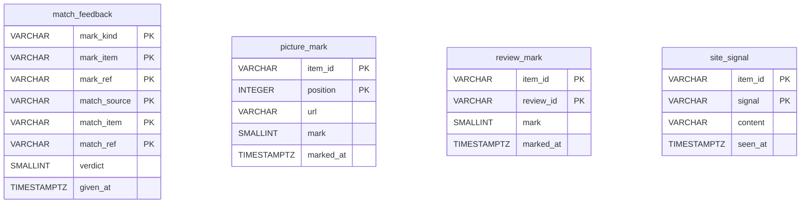

# A source's ratings: `ratings`

`sources/<source>/ratings.mv.db` — The user's own judgments of what a source's works show: their pictures and reviews, and what the user did on the site. Backed up on every start. The grades and the marks of interest stand on the normalized works, in the [dictionaries](dictionaries.md).

| Table | What it holds |
|---|---|
| `picture_mark` | the user's mark of a picture |
| `review_mark` | the user's mark of a review |
| `match_feedback` | the user's word on a match the application found for a mark |
| `site_signal` | the user's own action seen on the site: read, liked, on a shelf — shown, never trained on |

The diagram is made of the migrations by `SchemaDocsTest`: change it with them.

