# A source: `source`

`sources/<source>/source.mv.db` — What a site says of its works, one of every source: the works, their facets, numbers, texts, pictures, reviews and parts, the pages kept, and their vectors — a compressed form of the same. Recomputable from the site; the source's plugin may add tables of its own (not shown here).

| Table | What it holds |
|---|---|
| `item` | a work of the site: its id, address, title, version and dates |
| `item_version` | every version of a work seen |
| `item_facet` | a work's value of a facet (tags, status, author, fandom…) by its stable key, in the site's order |
| `facet_value` | the name of a value the site names by key (a tag's id) |
| `facet_value_description` | what the site says a value means (a tag's own page) |
| `facet_value_vector` | the vector of a value's name, held against texts to tell whether the value fits them |
| `item_number` | a work's number: words, chapters, likes… |
| `item_text` | a work's text by role: the description, the notes… |
| `text_vector` | the vector of a text, with the hash of the text and the encoder |
| `text_window` | the vector of every window of a text longer than one window of the encoder |
| `phrase_vector` | the vector of a short text — a review, a tag's name, a phrase of the search — by the key of the text |
| `picture` | a work's picture: the cover first, then the screenshots |
| `item_picture_vector` | the cover's vector and the mean direction of the screenshots |
| `review` | an opinion of another reader, its text kept by the key it is encoded under |
| `part` | a part of a work's text — a chapter — kept whole |
| `part_vector` | the vector of every window of a part |
| `part_paragraph_vector` | the vector of every paragraph of a part — a line with a letter in it — what the tags are held against to be offered by the text |
| `set_vector` | a work's set — screenshots, reviews, windows of its text — as one vector of fixed length |
| `captured_page` | a page kept, gzipped, to be read again when the parser changes |

The diagram is made of the migrations by `SchemaDocsTest`: change it with them.

```mermaid
erDiagram
    captured_page {
        VARCHAR url PK
        VARCHAR item_id "null"
        TIMESTAMPTZ captured_at
        INTEGER parser_version
        BLOB html
    }
    facet_value {
        VARCHAR facet PK
        VARCHAR value_key PK
        VARCHAR name
    }
    facet_value_description {
        VARCHAR facet PK
        VARCHAR value_key PK
        VARCHAR description
    }
    facet_value_vector {
        VARCHAR facet PK
        VARCHAR value_key PK
        VARCHAR encoder
        VARCHAR name_hash
        VARBINARY vec
    }
    item {
        VARCHAR item_id PK
        VARCHAR url
        VARCHAR title
        VARCHAR version
        TIMESTAMPTZ updated_at
        TIMESTAMPTZ first_seen_at
    }
    item_facet {
        VARCHAR item_id PK, FK
        VARCHAR facet PK
        VARCHAR value_key PK
        INTEGER position
    }
    item_number {
        VARCHAR item_id PK, FK
        VARCHAR number_key PK
        DOUBLE content
    }
    item_picture_vector {
        VARCHAR item_id PK, FK
        VARCHAR block PK
        VARCHAR encoder
        VARBINARY vec
    }
    item_text {
        VARCHAR item_id PK, FK
        VARCHAR text_key PK
        CLOB content
    }
    item_version {
        VARCHAR item_id PK, FK
        VARCHAR version PK
        TIMESTAMPTZ updated_at
        TIMESTAMPTZ seen_at
    }
    part {
        VARCHAR item_id PK, FK
        VARCHAR part_id PK
        INTEGER position
        VARCHAR title "null"
        CLOB content "null"
        TIMESTAMPTZ published_at "null"
        VARCHAR encoded_hash "null"
        VARCHAR encoder "null"
        VARCHAR paragraphs_hash "null"
        VARCHAR paragraphs_encoder "null"
    }
    part_paragraph_vector {
        VARCHAR item_id PK, FK
        VARCHAR part_id PK, FK
        INTEGER paragraph_no PK
        VARBINARY vec
    }
    part_vector {
        VARCHAR item_id PK, FK
        VARCHAR part_id PK, FK
        INTEGER window_no PK
        VARBINARY vec
    }
    phrase_vector {
        BIGINT text_key PK
        VARCHAR encoder
        VARBINARY vec
    }
    picture {
        VARCHAR item_id PK, FK
        INTEGER position PK
        VARCHAR url
        VARCHAR preview_file "null"
        VARCHAR full_file "null"
        VARBINARY vec "null"
        VARCHAR encoder "null"
        TIMESTAMPTZ analyzed_at "null"
        VARCHAR error "null"
        INTEGER failures
        TIMESTAMPTZ retry_at "null"
    }
    review {
        VARCHAR item_id PK, FK
        VARCHAR review_id PK
        VARCHAR author "null"
        DOUBLE stars "null"
        CLOB content
        TIMESTAMPTZ posted_at "null"
        BIGINT text_key "null"
    }
    set_vector {
        VARCHAR item_id PK, FK
        VARCHAR kind PK
        BIGINT embedding_id
        INTEGER source
        VARBINARY vec
    }
    text_vector {
        VARCHAR item_id PK, FK
        VARCHAR text_key PK
        VARCHAR encoder
        VARCHAR text_hash
        VARBINARY vec
        INTEGER windows "null"
    }
    text_window {
        VARCHAR item_id PK, FK
        VARCHAR text_key PK
        INTEGER window_no PK
        VARBINARY vec
    }
    item ||--o{ item_facet : "item_id"
    item ||--o{ item_number : "item_id"
    item ||--o{ item_picture_vector : "item_id"
    item ||--o{ item_text : "item_id"
    item ||--o{ item_version : "item_id"
    item ||--o{ part : "item_id"
    item ||--o{ picture : "item_id"
    item ||--o{ review : "item_id"
    item ||--o{ set_vector : "item_id"
    item ||--o{ text_vector : "item_id"
    item ||--o{ text_window : "item_id"
    part ||--o{ part_paragraph_vector : "item_id, part_id"
    part ||--o{ part_vector : "item_id, part_id"
```

