# A source: `source`

`sources/<source>/source.mv.db` — What a site says of its works, one of every source: the works, their facets, numbers, texts, pictures, reviews and parts, the pages kept, and their vectors — a compressed form of the same. Recomputable from the site; the source's plugin may add tables of its own (not shown here).

| Table | What it holds |
|---|---|
| `item` | a work of the site, kept by a number of the application's own (`internal_id`: the key H2 keeps the rows by, a row read by it one tree of the file) beside the site's id (`site_id`, unique: a site that changes its works' ids changes it alone — every other table binds a work by its number, `item_id`): its address, title, version and dates; the texts the site gives it, a column each the source's own migrations make (`site_text_<key>`, `SiteTexts.columnOf`: the description, the notes…), read with its row; the words and the characters of its kept texts, every part's summed as its parts are written (`text_words`, `text_chars`), and its characters by their classes — letters of one, two, three or more bytes in UTF-8, punctuation of one or more, spaces, breaks, the rest (`text_letters_1` … `text_other`) — what a site's count of characters is told of; when what the index of the list holds of it last changed (`changed_at`): its document written anew by the next writing of the index; when every outer kind of its data last changed — what the site says of it (`data_at`), its chapters' texts (`chapters_at`), its reviews (`reviews_at`), its pictures analysed (`pictures_at`) —: what the stages of the tasks over the works take it by, each by the kinds it reads |
| `item_version` | every version of a work seen |
| `item_facet` | a work's value of a facet (tags, status, author, fandom…) by its stable key, in the site's order, with its name as the work's page wrote it |
| `facet_value` | the name of a value the site names by key (a tag's id) |
| `facet_value_description` | what the site says a value means (a tag's own page, what a fandom is of) |
| `facet_value_synonym` | another name the site gives a value (a tag's synonym): a value of its own, bound to the tag the value is bound to |
| `facet_value_parent` | a value the site puts another under (AO3's metatags and subtags): the tag or the universe of the one put under that of the other |
| `facet_value_vector` | the vector of a value's name, held against texts to tell whether the value fits them |
| `item_number` | a work's number: words, chapters, likes… |
| `text_vector` | the vector of a text, with the hash of the text and the encoder; how many windows it has, and what they were made by (`windows_by`: the encoder and its way of cutting a text); the key of the projection its pieces' codes were made by (`pieces`) and of the centre the full-text vectors of its windows were made by (`full_text`), the codes and the full-text vectors in the store of the parts under `text:<key>` |
| `text_window` | the vector of every window of a text longer than one window of the encoder: a scene of it, overlapping the next by half — what the full-text vectors the search finds a piece of a long text by are made of |
| `phrase_vector` | the vector of a short text — a review, a tag's name, a phrase of the search — by the key of the text |
| `picture` | a work's picture: the cover first, then the screenshots |
| `item_picture_vector` | the cover's vector and the mean direction of the screenshots |
| `review` | an opinion of another reader, its text kept by the key it is encoded under |
| `series` | a series of the site — a cycle of works — as its own page, or a list of an author's series, said it last: its page, title, description, status and dates |
| `series_place` | the number of a work in a series of the site, as the site tells it; that the work is of the series is its facet of the series |
| `part` | a part of a work's text — a chapter: what it has, its text and its vectors kept outside the database, in the source's store of parts (`sources/<source>/parts/`, `PartStore`, RocksDB): the hash of its text (a part has a text when it is written), its characters and words counted as its text is written; of its windows' vectors — overlapping by half, what the models read of it and what the full-text vectors the search finds a scene of a chapter by are made of — the encoder, the text's hash and how many (`windows`); of its paragraphs' vectors — what the tags are held against to be offered by the text — the encoder and the text's hash; of its pieces' codes — what the search finds the place of a line in it by — the key of the projection they were made by (`pieces`); of the full-text vectors of its windows — what the search finds it by meaning by — the key of the centre they were made by (`full_text`); when a whole table of contents of its site no longer named it (`taken_off_at`), its text kept but nothing of the work made of it |
| `set_vector` | a work's set — screenshots, reviews, windows of its text — as one vector of fixed length |
| `item_manner` | the manner of a work's text: the share in it of every word its content type measures a manner by, standardised, and the hash of the texts it was made of |
| `captured_page` | a page kept, gzipped, to be read again when the parser changes |
| `wanted_page` | a request of the site the source wants the browser to make for it — what a tag means — asked once, done when the answer came |

The diagram is made of the migrations by `SchemaDocsTest`: change it with them.

```mermaid
erDiagram
    captured_page {
        VARCHAR url PK
        BIGINT item_id "null"
        TIMESTAMPTZ captured_at
        INTEGER parser_version
        BLOB html
    }
    facet_value {
        VARCHAR facet PK
        VARCHAR value_key PK
        VARCHAR name
    }
    facet_value_description {
        VARCHAR facet PK
        VARCHAR value_key PK
        VARCHAR description
    }
    facet_value_parent {
        VARCHAR facet PK
        VARCHAR value_key PK
        VARCHAR parent_key PK
    }
    facet_value_synonym {
        VARCHAR facet PK
        VARCHAR synonym_key PK
        VARCHAR value_key
    }
    facet_value_vector {
        VARCHAR facet PK
        VARCHAR value_key PK
        VARCHAR encoder
        VARCHAR name_hash
        VARBINARY vec
    }
    item {
        BIGINT internal_id PK
        VARCHAR site_id
        VARCHAR url
        VARCHAR title
        VARCHAR version
        TIMESTAMPTZ updated_at
        TIMESTAMPTZ first_seen_at
        INTEGER text_words "null"
        INTEGER text_chars "null"
        INTEGER text_letters_1 "null"
        INTEGER text_letters_2 "null"
        INTEGER text_letters_3 "null"
        INTEGER text_punctuation_1 "null"
        INTEGER text_punctuation_2 "null"
        INTEGER text_spaces "null"
        INTEGER text_breaks "null"
        INTEGER text_other "null"
        TIMESTAMPTZ changed_at "null"
        TIMESTAMPTZ data_at "null"
        TIMESTAMPTZ chapters_at "null"
        TIMESTAMPTZ reviews_at "null"
        TIMESTAMPTZ pictures_at "null"
    }
    item_facet {
        BIGINT item_id PK, FK
        VARCHAR facet PK
        VARCHAR value_key PK
        INTEGER position
        VARCHAR name "null"
    }
    item_manner {
        BIGINT item_id PK, FK
        BIGINT words_id
        VARCHAR text_hash
        VARBINARY vec
    }
    item_number {
        BIGINT item_id PK, FK
        VARCHAR number_key PK
        DOUBLE content
    }
    item_picture_vector {
        BIGINT item_id PK, FK
        VARCHAR block PK
        VARCHAR encoder
        VARBINARY vec
    }
    item_version {
        BIGINT item_id PK, FK
        VARCHAR version PK
        TIMESTAMPTZ updated_at
        TIMESTAMPTZ seen_at
    }
    part {
        BIGINT item_id PK, FK
        VARCHAR part_id PK
        INTEGER position
        VARCHAR title "null"
        TIMESTAMPTZ published_at "null"
        VARCHAR encoded_hash "null"
        VARCHAR encoder "null"
        VARCHAR paragraphs_hash "null"
        VARCHAR paragraphs_encoder "null"
        INTEGER chars "null"
        INTEGER words "null"
        VARCHAR content_hash "null"
        INTEGER windows "null"
        TIMESTAMPTZ taken_off_at "null"
        VARCHAR pieces "null"
        VARCHAR full_text "null"
    }
    phrase_vector {
        BIGINT text_key PK
        VARCHAR encoder
        VARBINARY vec
    }
    picture {
        BIGINT item_id PK, FK
        INTEGER position PK
        VARCHAR url
        VARCHAR preview_file "null"
        VARCHAR full_file "null"
        VARBINARY vec "null"
        VARCHAR encoder "null"
        TIMESTAMPTZ analyzed_at "null"
        VARCHAR error "null"
        INTEGER failures
        TIMESTAMPTZ retry_at "null"
    }
    review {
        BIGINT item_id PK, FK
        VARCHAR review_id PK
        VARCHAR author "null"
        DOUBLE stars "null"
        CLOB content
        TIMESTAMPTZ posted_at "null"
        BIGINT text_key "null"
    }
    series {
        VARCHAR series_key PK
        VARCHAR url
        VARCHAR title "null"
        CLOB description "null"
        VARCHAR status "null"
        TIMESTAMPTZ begun_at "null"
        TIMESTAMPTZ updated_at "null"
        TIMESTAMPTZ seen_at
        TIMESTAMPTZ work_seen_at "null"
    }
    series_place {
        VARCHAR series_key PK
        BIGINT item_id PK, FK
        INTEGER position
    }
    set_vector {
        BIGINT item_id PK, FK
        VARCHAR kind PK
        BIGINT embedding_id
        INTEGER source
        VARBINARY vec
    }
    text_vector {
        BIGINT item_id PK, FK
        VARCHAR text_key PK
        VARCHAR encoder
        VARCHAR text_hash
        VARBINARY vec
        INTEGER windows "null"
        VARCHAR windows_by "null"
        VARCHAR pieces "null"
        VARCHAR full_text "null"
    }
    text_window {
        BIGINT item_id PK, FK
        VARCHAR text_key PK
        INTEGER window_no PK
        VARBINARY vec
    }
    wanted_page {
        VARCHAR url PK
        VARCHAR form "null"
        TIMESTAMPTZ wanted_at
        TIMESTAMPTZ fetched_at "null"
    }
    item ||--o{ item_facet : "item_id"
    item ||--o{ item_manner : "item_id"
    item ||--o{ item_number : "item_id"
    item ||--o{ item_picture_vector : "item_id"
    item ||--o{ item_version : "item_id"
    item ||--o{ part : "item_id"
    item ||--o{ picture : "item_id"
    item ||--o{ review : "item_id"
    item ||--o{ series_place : "item_id"
    item ||--o{ set_vector : "item_id"
    item ||--o{ text_vector : "item_id"
    item ||--o{ text_window : "item_id"
```

