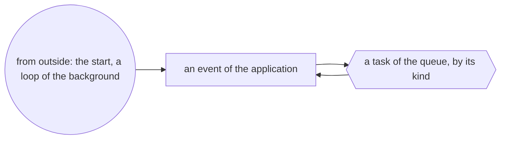

# The events and the works of the application

Made of the compiled code by `EventFlowDocsTest` (`gradlew :app:test --tests "*EventFlowDocsTest*"`): a change
of the code that changes what leads to what fails the test, and the test writes this file anew — commit it.
What it reads is said in `EventFlow`: an event is an object of a class some `@EventListener` listens to; a work
is planned by `Tasks.plan` or run by `Tasks.run`, its kind named where it is planned.

An arrow is "may lead to, directly": the events a thing makes, the works it plans. A request's events and
works go on as the diagram shows.

## Legend

- a circle: what comes from outside the flow — `start`, the start of the application (the listeners of
  `ApplicationReadyEvent`) deciding of the data; `left by the last run`, the works the last run left in the
  queue planned again by their owners (`Tasks.resume`); a loop of the background by its name
  (`Background.start`, `every`, `endless`);
- a box: an event of the application, by its class;
- a hexagon: a task of the queue, by its `TaskKind`;
- a request of the interface or the extension: a row of the table below, by its operation's id.

## What leads to what

```mermaid
flowchart LR

    o_job__(("job-*"))
    o_pictures(("pictures"))
    o_reparse(("reparse"))
    o_start(("start"))
    o_universes_languages(("universes-languages"))
    e_FandomRelationChangeEvent["FandomRelationChangeEvent"]
    e_FandomVectorChangeEvent["FandomVectorChangeEvent"]
    e_FieldModelFitEvent["FieldModelFitEvent"]
    e_RatedWorkValueFillEvent["RatedWorkValueFillEvent"]
    e_SearchJudgmentEvent["SearchJudgmentEvent"]
    e_SiteItemCastEncodeEvent["SiteItemCastEncodeEvent"]
    e_SiteItemChapterChangeEvent["SiteItemChapterChangeEvent"]
    e_SiteItemChapterVectorChangeEvent["SiteItemChapterVectorChangeEvent"]
    e_SiteItemMarkChangeEvent["SiteItemMarkChangeEvent"]
    e_SiteItemPictureAnalysisEvent["SiteItemPictureAnalysisEvent"]
    e_SiteItemPictureDownloadEvent["SiteItemPictureDownloadEvent"]
    e_SiteItemPictureListEvent["SiteItemPictureListEvent"]
    e_SiteItemRemoveEvent["SiteItemRemoveEvent"]
    e_SiteItemSetVectorChangeEvent["SiteItemSetVectorChangeEvent"]
    e_SiteItemTextVectorChangeEvent["SiteItemTextVectorChangeEvent"]
    e_SiteItemWriteEvent["SiteItemWriteEvent"]
    e_SiteTagSynonymChangeEvent["SiteTagSynonymChangeEvent"]
    e_TagChangeEvent["TagChangeEvent"]
    e_TagTextAnswerEvent["TagTextAnswerEvent"]
    e_WorkChangeEvent["WorkChangeEvent"]
    e_WorkDocumentWriteEvent["WorkDocumentWriteEvent"]
    e_WorkFieldChangeEvent["WorkFieldChangeEvent"]
    e_WorkFieldFillEvent["WorkFieldFillEvent"]
    e_WorkGradeChangeEvent["WorkGradeChangeEvent"]
    e_WorkGroupChangeEvent["WorkGroupChangeEvent"]
    e_WorkInterestChangeEvent["WorkInterestChangeEvent"]
    e_WorkMannerChangeEvent["WorkMannerChangeEvent"]
    e_WorkPredictionChangeEvent["WorkPredictionChangeEvent"]
    e_WorkPredictionFillEvent["WorkPredictionFillEvent"]
    e_WorkTextVectorFillEvent["WorkTextVectorFillEvent"]
    w_analyseSiteItemPictures{{"analyseSiteItemPictures"}}
    w_compareFieldMethods{{"compareFieldMethods"}}
    w_compareGradeScorers{{"compareGradeScorers"}}
    w_compareInterestScorers{{"compareInterestScorers"}}
    w_countFandomWorks{{"countFandomWorks"}}
    w_countTags{{"countTags"}}
    w_draftWorkLayer{{"draftWorkLayer"}}
    w_encodeFandomNames{{"encodeFandomNames"}}
    w_encodeSiteItemCasts{{"encodeSiteItemCasts"}}
    w_encodeSiteItemChapters{{"encodeSiteItemChapters"}}
    w_encodeSiteItemTexts{{"encodeSiteItemTexts"}}
    w_encodeTagNames{{"encodeTagNames"}}
    w_eraseDifferentInSeries{{"eraseDifferentInSeries"}}
    w_fillWorkFields{{"fillWorkFields"}}
    w_fitDuplicateModel{{"fitDuplicateModel"}}
    w_fitFandomLikeness{{"fitFandomLikeness"}}
    w_fitFieldModels{{"fitFieldModels"}}
    w_fitGradeModels{{"fitGradeModels"}}
    w_fitHeldOutModel{{"fitHeldOutModel"}}
    w_fitSearchWeights{{"fitSearchWeights"}}
    w_fitSetDirections{{"fitSetDirections"}}
    w_fitTagTextModel{{"fitTagTextModel"}}
    w_indexWorkTexts{{"indexWorkTexts"}}
    w_keepOutWorks{{"keepOutWorks"}}
    w_keyNamedValues{{"keyNamedValues"}}
    w_letGoUnusedFandoms{{"letGoUnusedFandoms"}}
    w_makeSiteItemSetVectors{{"makeSiteItemSetVectors"}}
    w_makeWorkManners{{"makeWorkManners"}}
    w_measurePartWorth{{"measurePartWorth"}}
    w_measureWorkSizes{{"measureWorkSizes"}}
    w_nameFandoms{{"nameFandoms"}}
    w_nameTags{{"nameTags"}}
    w_predictWorks{{"predictWorks"}}
    w_readScorerInput{{"readScorerInput"}}
    w_removeSiteItemTexts{{"removeSiteItemTexts"}}
    w_renameFandoms{{"renameFandoms"}}
    w_searchAuthorDuplicates{{"searchAuthorDuplicates"}}
    w_searchDuplicates{{"searchDuplicates"}}
    w_searchFieldModelAnew{{"searchFieldModelAnew"}}
    w_weighParts{{"weighParts"}}
    w_writeListIndex{{"writeListIndex"}}
    w_writeWorkValues{{"writeWorkValues"}}
    o_job__ --> e_SiteItemChapterChangeEvent
    o_job__ --> e_SiteItemPictureListEvent
    o_job__ --> e_SiteItemRemoveEvent
    o_job__ --> e_SiteItemWriteEvent
    o_job__ --> e_SiteTagSynonymChangeEvent
    o_job__ --> e_WorkGroupChangeEvent
    o_job__ --> w_fitGradeModels
    o_pictures --> e_SiteItemChapterChangeEvent
    o_pictures --> e_SiteItemPictureDownloadEvent
    o_pictures --> e_SiteItemPictureListEvent
    o_pictures --> e_SiteItemRemoveEvent
    o_pictures --> e_SiteItemWriteEvent
    o_pictures --> e_SiteTagSynonymChangeEvent
    o_pictures --> e_WorkGroupChangeEvent
    o_reparse --> e_SiteItemChapterChangeEvent
    o_reparse --> e_SiteItemPictureListEvent
    o_reparse --> e_SiteItemRemoveEvent
    o_reparse --> e_SiteItemWriteEvent
    o_reparse --> e_SiteTagSynonymChangeEvent
    o_reparse --> e_WorkGroupChangeEvent
    o_start --> e_SiteItemChapterChangeEvent
    o_start --> e_SiteItemPictureListEvent
    o_start --> e_SiteItemRemoveEvent
    o_start --> e_SiteItemWriteEvent
    o_start --> e_SiteTagSynonymChangeEvent
    o_start --> e_WorkGroupChangeEvent
    o_start --> w_analyseSiteItemPictures
    o_start --> w_countFandomWorks
    o_start --> w_encodeSiteItemTexts
    o_start --> w_fitGradeModels
    o_start --> w_fitTagTextModel
    o_start --> w_indexWorkTexts
    o_start --> w_makeSiteItemSetVectors
    o_start --> w_searchAuthorDuplicates
    o_start --> w_searchDuplicates
    o_start --> w_writeListIndex
    o_universes_languages --> e_WorkChangeEvent
    e_FandomRelationChangeEvent --> w_fitFandomLikeness
    e_FandomVectorChangeEvent --> w_fitFandomLikeness
    e_FieldModelFitEvent --> w_fillWorkFields
    e_RatedWorkValueFillEvent --> w_fitGradeModels
    e_SearchJudgmentEvent --> w_fitSearchWeights
    e_SiteItemCastEncodeEvent --> w_fitFieldModels
    e_SiteItemCastEncodeEvent --> w_writeListIndex
    e_SiteItemChapterChangeEvent --> w_encodeSiteItemChapters
    e_SiteItemChapterChangeEvent --> w_fitFieldModels
    e_SiteItemChapterChangeEvent --> w_makeWorkManners
    e_SiteItemChapterChangeEvent --> w_measureWorkSizes
    e_SiteItemChapterChangeEvent --> w_writeListIndex
    e_SiteItemChapterVectorChangeEvent --> w_fitFieldModels
    e_SiteItemChapterVectorChangeEvent --> w_makeSiteItemSetVectors
    e_SiteItemChapterVectorChangeEvent --> w_writeListIndex
    e_SiteItemMarkChangeEvent --> w_fitGradeModels
    e_SiteItemPictureAnalysisEvent --> w_fitGradeModels
    e_SiteItemPictureAnalysisEvent --> w_makeSiteItemSetVectors
    e_SiteItemPictureDownloadEvent --> w_analyseSiteItemPictures
    e_SiteItemRemoveEvent --> e_WorkChangeEvent
    e_SiteItemRemoveEvent --> w_fitGradeModels
    e_SiteItemRemoveEvent --> w_removeSiteItemTexts
    e_SiteItemSetVectorChangeEvent --> w_fitGradeModels
    e_SiteItemTextVectorChangeEvent --> w_fitFieldModels
    e_SiteItemWriteEvent --> e_WorkChangeEvent
    e_SiteItemWriteEvent --> e_WorkGroupChangeEvent
    e_SiteItemWriteEvent --> w_countFandomWorks
    e_SiteItemWriteEvent --> w_encodeSiteItemCasts
    e_SiteItemWriteEvent --> w_eraseDifferentInSeries
    e_SiteItemWriteEvent --> w_keyNamedValues
    e_SiteItemWriteEvent --> w_letGoUnusedFandoms
    e_SiteItemWriteEvent --> w_makeSiteItemSetVectors
    e_SiteItemWriteEvent --> w_makeWorkManners
    e_SiteItemWriteEvent --> w_measureWorkSizes
    e_SiteItemWriteEvent --> w_renameFandoms
    e_SiteTagSynonymChangeEvent --> w_encodeTagNames
    e_SiteTagSynonymChangeEvent --> w_nameTags
    e_TagChangeEvent --> w_encodeTagNames
    e_TagChangeEvent --> w_fitGradeModels
    e_TagChangeEvent --> w_measureWorkSizes
    e_TagTextAnswerEvent --> w_fitTagTextModel
    e_WorkChangeEvent --> w_draftWorkLayer
    e_WorkChangeEvent --> w_encodeFandomNames
    e_WorkChangeEvent --> w_encodeTagNames
    e_WorkChangeEvent --> w_fitFieldModels
    e_WorkChangeEvent --> w_nameFandoms
    e_WorkChangeEvent --> w_nameTags
    e_WorkChangeEvent --> w_writeListIndex
    e_WorkDocumentWriteEvent --> w_encodeSiteItemTexts
    e_WorkFieldChangeEvent --> w_fitFieldModels
    e_WorkFieldChangeEvent --> w_fitGradeModels
    e_WorkFieldChangeEvent --> w_measureWorkSizes
    e_WorkFieldChangeEvent --> w_writeListIndex
    e_WorkFieldFillEvent --> w_predictWorks
    e_WorkGradeChangeEvent --> w_fitGradeModels
    e_WorkGradeChangeEvent --> w_nameTags
    e_WorkGradeChangeEvent --> w_writeWorkValues
    e_WorkGroupChangeEvent --> w_eraseDifferentInSeries
    e_WorkGroupChangeEvent --> w_makeWorkManners
    e_WorkGroupChangeEvent --> w_writeListIndex
    e_WorkInterestChangeEvent --> w_fitGradeModels
    e_WorkInterestChangeEvent --> w_writeWorkValues
    e_WorkMannerChangeEvent --> w_fitGradeModels
    e_WorkPredictionChangeEvent --> w_writeWorkValues
    e_WorkPredictionFillEvent --> w_indexWorkTexts
    e_WorkTextVectorFillEvent --> w_fillWorkFields
    w_analyseSiteItemPictures --> e_SiteItemPictureAnalysisEvent
    w_compareGradeScorers --> w_readScorerInput
    w_compareInterestScorers --> w_readScorerInput
    w_encodeFandomNames --> e_FandomVectorChangeEvent
    w_encodeSiteItemCasts --> e_SiteItemCastEncodeEvent
    w_encodeSiteItemChapters --> e_SiteItemChapterVectorChangeEvent
    w_encodeSiteItemTexts --> e_SiteItemTextVectorChangeEvent
    w_encodeSiteItemTexts --> e_WorkTextVectorFillEvent
    w_fillWorkFields --> e_RatedWorkValueFillEvent
    w_fillWorkFields --> e_WorkFieldFillEvent
    w_fitFieldModels --> e_FieldModelFitEvent
    w_fitGradeModels --> e_WorkPredictionChangeEvent
    w_fitGradeModels --> w_predictWorks
    w_keepOutWorks --> e_SiteItemRemoveEvent
    w_makeSiteItemSetVectors --> e_SiteItemSetVectorChangeEvent
    w_makeSiteItemSetVectors --> w_fitSetDirections
    w_makeWorkManners --> e_WorkMannerChangeEvent
    w_nameTags --> w_countTags
    w_predictWorks --> e_WorkPredictionChangeEvent
    w_predictWorks --> e_WorkPredictionFillEvent
    w_searchFieldModelAnew --> w_fitFieldModels
    w_writeListIndex --> e_WorkDocumentWriteEvent
```

## The requests

| Request | Events | Works |
|---|---|---|
| `addUniverse` | WorkChangeEvent | — |
| `answerAuthors` | WorkGroupChangeEvent | — |
| `answerDuplicate` | WorkGradeChangeEvent, WorkInterestChangeEvent | fitDuplicateModel |
| `answerMarking` | WorkFieldChangeEvent | — |
| `answerTagByText` | TagTextAnswerEvent, WorkFieldChangeEvent | — |
| `bindSiteFandom` | FandomRelationChangeEvent, WorkChangeEvent | renameFandoms |
| `bindSiteTag` | TagChangeEvent, WorkChangeEvent | nameTags |
| `bindTagEntry` | TagChangeEvent, WorkChangeEvent | — |
| `bindUniverseEntry` | WorkChangeEvent | — |
| `cancelJob` | SiteItemChapterChangeEvent, SiteItemPictureListEvent, SiteItemRemoveEvent, SiteItemWriteEvent, SiteTagSynonymChangeEvent, WorkGroupChangeEvent | — |
| `capturePage` | SiteItemChapterChangeEvent, SiteItemPictureListEvent, SiteItemRemoveEvent, SiteItemWriteEvent, SiteTagSynonymChangeEvent, WorkGroupChangeEvent | — |
| `chooseFacetCast` | — | searchFieldModelAnew |
| `chooseFacetMethod` | — | searchFieldModelAnew |
| `chooseInterestScorer` | — | fitGradeModels |
| `choosePairMethod` | — | searchDuplicates |
| `chooseScorer` | — | fitGradeModels |
| `chooseUniverseCharacters` | WorkChangeEvent | — |
| `chooseUniverseClass` | WorkChangeEvent | — |
| `chooseUniverseEntry` | WorkChangeEvent | — |
| `completeFacet` | WorkFieldChangeEvent | — |
| `correctFacet` | TagChangeEvent, WorkChangeEvent, WorkFieldChangeEvent | nameTags |
| `correctField` | SiteItemTextVectorChangeEvent, WorkChangeEvent, WorkPredictionChangeEvent | fitGradeModels |
| `createTagAbove` | TagChangeEvent, WorkChangeEvent | nameTags |
| `fitPairModels` | — | fitDuplicateModel |
| `getExplanation` | — | fitHeldOutModel |
| `getHeldOut` | — | fitHeldOutModel |
| `getItem` | SiteItemTextVectorChangeEvent, WorkPredictionChangeEvent | — |
| `getPage` | SiteItemTextVectorChangeEvent, WorkPredictionChangeEvent | — |
| `getPicture` | SiteItemChapterChangeEvent, SiteItemPictureListEvent, SiteItemRemoveEvent, SiteItemWriteEvent, SiteTagSynonymChangeEvent, WorkGroupChangeEvent | — |
| `giveMatchFeedback` | SiteItemMarkChangeEvent | — |
| `ignoreTag` | TagChangeEvent | — |
| `judgeSearch` | SearchJudgmentEvent | — |
| `keepOutTag` | — | keepOutWorks |
| `linkItem` | SiteItemTextVectorChangeEvent, WorkChangeEvent, WorkGradeChangeEvent, WorkInterestChangeEvent, WorkPredictionChangeEvent | fitGradeModels |
| `listHierarchyOffers` | — | nameTags |
| `listJobs` | SiteItemChapterChangeEvent, SiteItemPictureListEvent, SiteItemRemoveEvent, SiteItemWriteEvent, SiteTagSynonymChangeEvent, WorkGroupChangeEvent | — |
| `markInterest` | WorkInterestChangeEvent | — |
| `markPicture` | SiteItemMarkChangeEvent | — |
| `markReview` | SiteItemMarkChangeEvent | — |
| `measurePartWorth` | — | measurePartWorth |
| `measureWeighing` | — | weighParts |
| `nameTag` | TagChangeEvent, WorkChangeEvent | — |
| `nameUniverse` | FandomRelationChangeEvent, WorkChangeEvent | renameFandoms |
| `nameUniverseEntry` | WorkChangeEvent | — |
| `rateItem` | WorkGradeChangeEvent | — |
| `refreshItem` | SiteItemChapterChangeEvent, SiteItemPictureListEvent, SiteItemRemoveEvent, SiteItemTextVectorChangeEvent, SiteItemWriteEvent, SiteTagSynonymChangeEvent, WorkGroupChangeEvent, WorkPredictionChangeEvent | — |
| `refreshTagEntries` | TagChangeEvent, WorkChangeEvent | — |
| `refreshUniverse` | WorkChangeEvent | — |
| `relateTags` | TagChangeEvent, WorkChangeEvent | nameTags |
| `relateUniverses` | FandomRelationChangeEvent, WorkChangeEvent | renameFandoms |
| `removeItem` | SiteItemRemoveEvent | — |
| `resetUniverseClass` | WorkChangeEvent | — |
| `resetUniverseEntry` | WorkChangeEvent | — |
| `searchAuthorDuplicates` | — | searchAuthorDuplicates |
| `searchDuplicates` | — | searchDuplicates |
| `searchFacetModel` | — | searchFieldModelAnew |
| `startFacetComparison` | — | compareFieldMethods |
| `startJob` | SiteItemChapterChangeEvent, SiteItemPictureListEvent, SiteItemRemoveEvent, SiteItemWriteEvent, SiteTagSynonymChangeEvent, WorkGroupChangeEvent | — |
| `startScorerComparison` | — | compareGradeScorers, compareInterestScorers |
| `takeOutSiteAuthor` | WorkGroupChangeEvent | — |
| `trainModel` | — | fitGradeModels |
| `unanswerDuplicate` | — | fitDuplicateModel |
| `unanswerMarking` | WorkFieldChangeEvent | — |
| `uncompleteFacet` | WorkFieldChangeEvent | — |
| `uncorrectFacet` | WorkFieldChangeEvent | — |
| `uncorrectField` | SiteItemTextVectorChangeEvent, WorkChangeEvent, WorkPredictionChangeEvent | fitGradeModels |
| `undoDuplicateWord` | WorkGradeChangeEvent, WorkInterestChangeEvent | fitDuplicateModel |
| `unlinkItem` | SiteItemTextVectorChangeEvent, WorkChangeEvent, WorkPredictionChangeEvent | fitGradeModels |
| `unmarkInterest` | WorkInterestChangeEvent | — |
| `unmarkPicture` | SiteItemMarkChangeEvent | — |
| `unmarkReview` | SiteItemMarkChangeEvent | — |
| `unrateItem` | WorkGradeChangeEvent | — |
