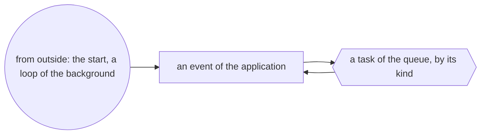
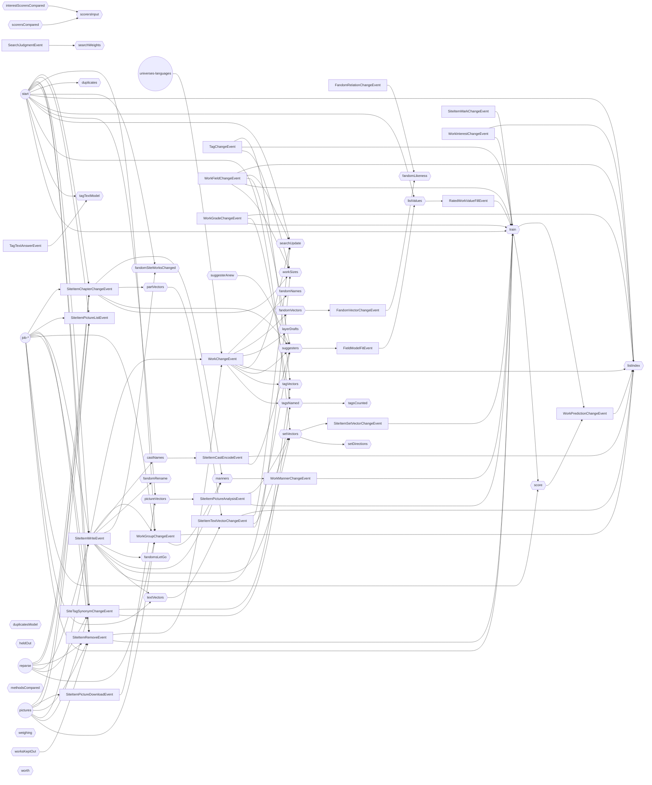

# The events and the works of the application

Made of the compiled code by `EventFlowDocsTest` (`gradlew :app:test --tests "*EventFlowDocsTest*"`): a change
of the code that changes what leads to what fails the test, and the test writes this file anew — commit it.
What it reads is said in `EventFlow`: an event is an object of a class some `@EventListener` listens to; a work
is planned by `Tasks.plan` or run by `Tasks.run`, its kind named where it is planned.

An arrow is "may lead to, directly": the events a thing makes, the works it plans. A request's events and
works go on as the diagram shows.

## Legend

- a circle: what comes from outside the flow — `start`, the start of the application (the listeners of
  `ApplicationReadyEvent`) deciding of the data; `left by the last run`, the works the last run left in the
  queue planned again by their owners (`Tasks.resume`); a loop of the background by its name
  (`Background.start`, `every`, `endless`);
- a box: an event of the application, by its class;
- a hexagon: a task of the queue, by its `TaskKind`;
- a request of the interface or the extension: a row of the table below, by its operation's id.

## What leads to what

## The requests

| Request | Events | Works |
|---|---|---|
| `addUniverse` | WorkChangeEvent | — |
| `answerAuthors` | WorkGroupChangeEvent | — |
| `answerDuplicate` | WorkGradeChangeEvent, WorkInterestChangeEvent | duplicatesModel |
| `answerMarking` | WorkFieldChangeEvent | — |
| `answerTagByText` | TagTextAnswerEvent, WorkFieldChangeEvent | — |
| `bindSiteFandom` | FandomRelationChangeEvent, WorkChangeEvent | fandomRename |
| `bindSiteTag` | TagChangeEvent, WorkChangeEvent | tagsNamed |
| `bindTagEntry` | TagChangeEvent, WorkChangeEvent | — |
| `bindUniverseEntry` | WorkChangeEvent | — |
| `cancelJob` | SiteItemChapterChangeEvent, SiteItemPictureListEvent, SiteItemRemoveEvent, SiteItemWriteEvent, SiteTagSynonymChangeEvent, WorkGroupChangeEvent | — |
| `capturePage` | SiteItemChapterChangeEvent, SiteItemPictureListEvent, SiteItemRemoveEvent, SiteItemWriteEvent, SiteTagSynonymChangeEvent, WorkGroupChangeEvent | — |
| `chooseFacetCast` | — | suggesterAnew |
| `chooseFacetMethod` | — | suggesterAnew |
| `chooseInterestScorer` | — | train |
| `choosePairMethod` | — | duplicates |
| `chooseScorer` | — | train |
| `chooseUniverseCharacters` | WorkChangeEvent | — |
| `chooseUniverseClass` | WorkChangeEvent | — |
| `chooseUniverseEntry` | WorkChangeEvent | — |
| `completeFacet` | WorkFieldChangeEvent | — |
| `correctFacet` | TagChangeEvent, WorkChangeEvent, WorkFieldChangeEvent | tagsNamed |
| `correctField` | WorkChangeEvent | train |
| `createTagAbove` | TagChangeEvent, WorkChangeEvent | tagsNamed |
| `fitPairModels` | — | duplicatesModel |
| `getExplanation` | — | heldOut |
| `getHeldOut` | — | heldOut |
| `getPicture` | SiteItemChapterChangeEvent, SiteItemPictureListEvent, SiteItemRemoveEvent, SiteItemWriteEvent, SiteTagSynonymChangeEvent, WorkGroupChangeEvent | — |
| `giveMatchFeedback` | SiteItemMarkChangeEvent | — |
| `ignoreTag` | TagChangeEvent | — |
| `judgeSearch` | SearchJudgmentEvent | — |
| `keepOutTag` | — | worksKeptOut |
| `linkItem` | WorkChangeEvent, WorkGradeChangeEvent, WorkInterestChangeEvent | train |
| `listHierarchyOffers` | — | tagsNamed |
| `listJobs` | SiteItemChapterChangeEvent, SiteItemPictureListEvent, SiteItemRemoveEvent, SiteItemWriteEvent, SiteTagSynonymChangeEvent, WorkGroupChangeEvent | — |
| `markInterest` | WorkInterestChangeEvent | — |
| `markPicture` | SiteItemMarkChangeEvent | — |
| `markReview` | SiteItemMarkChangeEvent | — |
| `measurePartWorth` | — | worth |
| `measureWeighing` | — | weighing |
| `nameTag` | TagChangeEvent, WorkChangeEvent | — |
| `nameUniverse` | FandomRelationChangeEvent, WorkChangeEvent | fandomRename |
| `nameUniverseEntry` | WorkChangeEvent | — |
| `rateItem` | WorkGradeChangeEvent | — |
| `refreshItem` | SiteItemChapterChangeEvent, SiteItemPictureListEvent, SiteItemRemoveEvent, SiteItemWriteEvent, SiteTagSynonymChangeEvent, WorkGroupChangeEvent, WorkPredictionChangeEvent | — |
| `refreshTagEntries` | TagChangeEvent, WorkChangeEvent | — |
| `refreshUniverse` | WorkChangeEvent | — |
| `relateTags` | TagChangeEvent, WorkChangeEvent | tagsNamed |
| `relateUniverses` | FandomRelationChangeEvent, WorkChangeEvent | fandomRename |
| `removeItem` | SiteItemRemoveEvent | — |
| `resetUniverseClass` | WorkChangeEvent | — |
| `resetUniverseEntry` | WorkChangeEvent | — |
| `searchDuplicates` | — | duplicates |
| `searchFacetModel` | — | suggesterAnew |
| `startFacetComparison` | — | methodsCompared |
| `startJob` | SiteItemChapterChangeEvent, SiteItemPictureListEvent, SiteItemRemoveEvent, SiteItemWriteEvent, SiteTagSynonymChangeEvent, WorkGroupChangeEvent | — |
| `startScorerComparison` | — | interestScorersCompared, scorersCompared |
| `takeOutSiteAuthor` | WorkGroupChangeEvent | — |
| `trainModel` | — | train |
| `unanswerDuplicate` | — | duplicatesModel |
| `unanswerMarking` | WorkFieldChangeEvent | — |
| `uncompleteFacet` | WorkFieldChangeEvent | — |
| `uncorrectFacet` | WorkFieldChangeEvent | — |
| `uncorrectField` | WorkChangeEvent | train |
| `undoDuplicateWord` | WorkGradeChangeEvent, WorkInterestChangeEvent | duplicatesModel |
| `unlinkItem` | WorkChangeEvent | train |
| `unmarkInterest` | WorkInterestChangeEvent | — |
| `unmarkPicture` | SiteItemMarkChangeEvent | — |
| `unmarkReview` | SiteItemMarkChangeEvent | — |
| `unrateItem` | WorkGradeChangeEvent | — |
