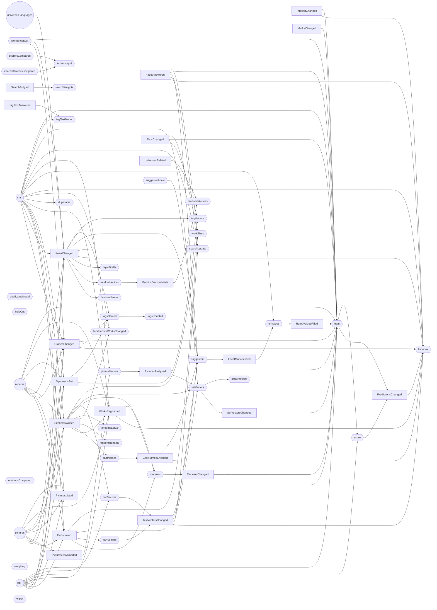

# The events and the works of the application

Made of the compiled code by `EventFlowDocsTest` (`gradlew :app:test --tests "*EventFlowDocsTest*"`): a change
of the code that changes what leads to what fails the test, and the test writes this file anew — commit it.
What it reads is said in `EventFlow`: an event is an object of a class some `@EventListener` listens to; a work
is planned by `Workload.plan` or run by `Workload.run`, its kind named where it is planned.

An arrow is "may lead to, directly": the events a thing makes, the works it plans. A request's events and
works go on as the diagram shows.

## Legend

- a circle: what comes from outside the flow — `start`, the start of the application (the listeners of
  `ApplicationReadyEvent`) deciding of the data; `left by the last run`, the works the last run left in the
  queue planned again by their owners (`Workload.resume`); a loop of the background by its name
  (`Background.start`, `every`, `endless`);
- a box: an event of the application, by its class;
- a hexagon: a work of the queue, by its `WorkKind`;
- a request of the interface or the extension: a row of the table below, by its operation's id.

## What leads to what

## The requests

| Request | Events | Works |
|---|---|---|
| `addUniverse` | ItemsChanged | — |
| `answerAuthors` | WorksRegrouped | — |
| `answerDuplicate` | GradesChanged, InterestChanged | duplicatesModel |
| `answerMarking` | FacetAnswered | — |
| `answerTagByText` | FacetAnswered, TagTextAnswered | — |
| `bindSiteFandom` | ItemsChanged, UniversesRelated | fandomRename |
| `bindSiteTag` | ItemsChanged, TagsChanged | tagsNamed |
| `bindTagEntry` | ItemsChanged, TagsChanged | — |
| `bindUniverseEntry` | ItemsChanged | — |
| `cancelJob` | GradesChanged, ItemsChanged, PartsSaved, PicturesListed, SiteItemsWritten, SynonymsSet, WorksRegrouped | train |
| `capturePage` | GradesChanged, ItemsChanged, PartsSaved, PicturesListed, SiteItemsWritten, SynonymsSet, WorksRegrouped | train |
| `chooseFacetCast` | — | suggesterAnew |
| `chooseFacetMethod` | — | suggesterAnew |
| `chooseInterestScorer` | — | train |
| `choosePairMethod` | — | duplicates |
| `chooseScorer` | — | train |
| `chooseUniverseCharacters` | ItemsChanged | — |
| `chooseUniverseClass` | ItemsChanged | — |
| `chooseUniverseEntry` | ItemsChanged | — |
| `completeFacet` | FacetAnswered | — |
| `correctFacet` | FacetAnswered, ItemsChanged, TagsChanged | tagsNamed |
| `correctField` | ItemsChanged | train |
| `createTagAbove` | ItemsChanged, TagsChanged | tagsNamed |
| `fitPairModels` | — | duplicatesModel |
| `getExplanation` | — | heldOut |
| `getHeldOut` | — | heldOut |
| `getPicture` | GradesChanged, ItemsChanged, PartsSaved, PicturesListed, SiteItemsWritten, SynonymsSet, WorksRegrouped | train |
| `giveMatchFeedback` | MarksChanged | — |
| `ignoreTag` | TagsChanged | — |
| `judgeSearch` | SearchJudged | — |
| `keepOutTag` | — | worksKeptOut |
| `linkItem` | GradesChanged, InterestChanged, ItemsChanged | train |
| `listHierarchyOffers` | — | tagsNamed |
| `listJobs` | GradesChanged, ItemsChanged, PartsSaved, PicturesListed, SiteItemsWritten, SynonymsSet, WorksRegrouped | train |
| `markInterest` | InterestChanged | — |
| `markPicture` | MarksChanged | — |
| `markReview` | MarksChanged | — |
| `measurePartWorth` | — | worth |
| `measureWeighing` | — | weighing |
| `nameTag` | ItemsChanged, TagsChanged | — |
| `nameUniverse` | ItemsChanged, UniversesRelated | fandomRename |
| `nameUniverseEntry` | ItemsChanged | — |
| `rateItem` | GradesChanged | — |
| `refreshItem` | GradesChanged, ItemsChanged, PartsSaved, PicturesListed, PredictionsChanged, SiteItemsWritten, SynonymsSet, WorksRegrouped | train |
| `refreshTagEntries` | ItemsChanged, TagsChanged | — |
| `refreshUniverse` | ItemsChanged | — |
| `relateTags` | ItemsChanged, TagsChanged | tagsNamed |
| `relateUniverses` | ItemsChanged, UniversesRelated | fandomRename |
| `removeItem` | GradesChanged, ItemsChanged | train |
| `resetUniverseClass` | ItemsChanged | — |
| `resetUniverseEntry` | ItemsChanged | — |
| `searchDuplicates` | — | duplicates |
| `searchFacetModel` | — | suggesterAnew |
| `startFacetComparison` | — | methodsCompared |
| `startJob` | GradesChanged, ItemsChanged, PartsSaved, PicturesListed, SiteItemsWritten, SynonymsSet, WorksRegrouped | train |
| `startScorerComparison` | — | interestScorersCompared, scorersCompared |
| `takeOutSiteAuthor` | WorksRegrouped | — |
| `trainModel` | — | train |
| `unanswerDuplicate` | — | duplicatesModel |
| `unanswerMarking` | FacetAnswered | — |
| `uncompleteFacet` | FacetAnswered | — |
| `uncorrectFacet` | FacetAnswered | — |
| `uncorrectField` | ItemsChanged | train |
| `undoDuplicateWord` | GradesChanged, InterestChanged | duplicatesModel |
| `unlinkItem` | ItemsChanged | train |
| `unmarkInterest` | InterestChanged | — |
| `unmarkPicture` | MarksChanged | — |
| `unmarkReview` | MarksChanged | — |
| `unrateItem` | GradesChanged | — |
